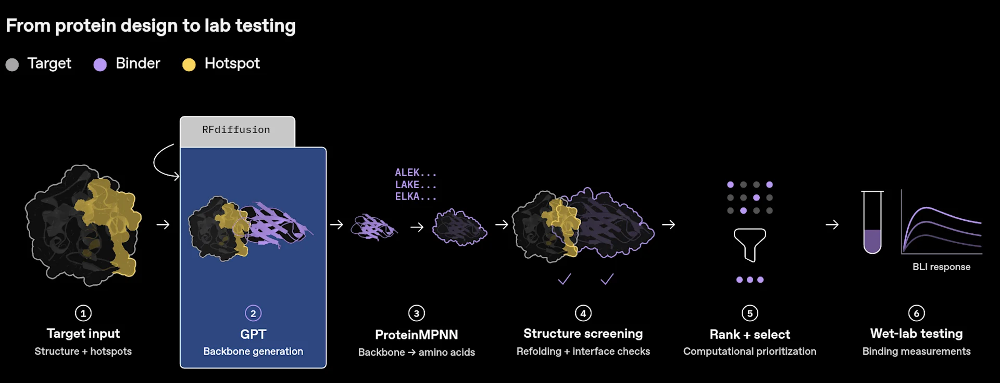

---
tags:
  - evidence
---

# Designing Small Proteins that Bind to a Target

> [GPT-6 Models Demonstrate Intrinsic Protein-Design Capabilities](https://openai.com/index/gpt-6-models-demonstrate-intrinsic-protein-design-capabilities/) 原文摘录:
>
> Our first laboratory experiment tested whether GPT‑6.2 could design small proteins that would bind to their intended targets. We compared computational measurements of quality against RFdiffusion, a specialized model for protein design, and found that GPT‑6.2's three-dimensional designs scored slightly lower while our latest internal models scored higher. For the lab experiment, we made proteins based on GPT‑6.2's designs and measured how strongly they bound to their targets.  
> 在第一项实验室实验中, 我们检验了 GPT-6.2 能否设计出与预定靶蛋白结合的小型蛋白质. 我们用计算指标评估设计质量, 并以蛋白质设计专用模型 RFdiffusion 为基准. GPT-6.2 的三维设计得分略低于 RFdiffusion, 而我们最新的内部模型得分更高. 在实验室里, 我们制备了按 GPT-6.2 的方案设计的蛋白质, 并测量了它们与各自靶蛋白的结合强度.  
>
> We gave GPT‑6.2 the three-dimensional structures of five target proteins and marked where we wanted a minibinder to attach. It then wrote code to create three-dimensional designs for potential minibinders, without using specialized protein AI models.  
> 我们向 GPT-6.2 提供了 5 种靶蛋白的三维结构, 并标出了希望小型结合蛋白与之结合的位置. 随后, GPT-6.2 编写代码, 生成候选小型结合蛋白的三维结构设计. 在这一步, 它没有调用专用的蛋白质 AI 模型.  
>
> To turn GPT‑6.2's three-dimensional designs into proteins we could test in the lab, we needed amino acid sequences that would fold into the proposed structures. We used a specialized AI model called SolubleMPNN to suggest sequences for each design. Other specialized protein models helped us select candidates predicted to fold as designed and bind at the intended site on the target.  
> 要把 GPT-6.2 的三维设计制成可在实验室中测试的蛋白质, 我们需要找到能折叠成这些结构的氨基酸序列. 我们用名为 SolubleMPNN 的专用 AI 模型为每个设计提出候选序列, 再用其他专用蛋白质模型筛选出预计能折叠成设计结构、并在预定位置与靶蛋白结合的候选序列.  
>
> We tested 322 minibinders against 5 targets in the lab. Of those, 35 (10.9%) tested positive for binding to their intended target. We found 5 hits for PD-L1 (a protein some cancers use to evade the immune system), 3 for IL-7Rα, 1 for TrkA, 8 for VEGF-A and 18 for IL-17A. The original RFdiffusion study⁠(opens in a new window) reported higher hit rates, but rates depend heavily on how strictly researchers filter designs before lab validation and their definition of binding. Nevertheless, our results provide early evidence that we can turn GPT‑6.2's three-dimensional designs into proteins that bind to their intended targets in the lab.  
> 我们在实验室里针对 5 种靶蛋白测试了 322 个候选小型结合蛋白, 其中 35 个 (10.9%) 检出与各自的预定靶蛋白结合. 各靶蛋白的命中数分别为 PD-L1 5 个、IL-7Rα 3 个、TrkA 1 个、VEGF-A 8 个、IL-17A 18 个. 某些癌症会利用 PD-L1 逃避免疫系统的攻击. RFdiffusion 的原始研究报告了更高的命中率, 但命中率很大程度上取决于实验前的筛选有多严格, 以及实验用什么标准判定结合阳性. 即便如此, 我们的结果仍提供了初步证据, 表明可以根据 GPT-6.2 的三维设计制备蛋白质, 并在实验室中测到这些蛋白质与预定靶蛋白结合.  
>
> 

**Target (靶蛋白)**: 研究者事先选定要结合的 protein, 并把它的 3D structure 交给 GPT‑6.2. 论文还区分了 target 和预期结合位点, 前者是整个实验所针对的分子, 后者是研究者希望小蛋白接触的表面区域. §2.1 默认会在 prompt 中指定靶蛋白表面的 **hotspot residues (热点残基)** 来标示这个区域. §2.1, p. 6.  
**Small Protein (小型蛋白质)**: 这里指新设计的那一方, 论文称为 **minibinder**, 可译作「小型结合蛋白」. §2.1 把设计长度设为 80-120 个 amino acid residue. 这是该任务的长度设定, 论文在这里给出的是实验范围. 实验一中, GPT‑6.2 设计 backbone, SolubleMPNN 为 backbone 生成 sequence, 实验室测试的是按候选序列制成的蛋白. §2.1, p. 6 · §2.5, p. 14.  
**Bind (结合)**: 指小蛋白和靶蛋白发生可测量的物理相互作用. 论文用 **BLI (生物层干涉法)** 记录两者结合和解离时的信号, 先做单浓度筛选, 再对部分命中做多浓度复测并估计亲和力. *Appendix B.2-B.3, pp. 61-62.  

`... computational measurements of quality against RFdiffusion ...`, 具体指用结构预测来评估 De novo 设计出来的小型结合蛋白骨架. 这一步发生在骨架生成之后. **GPT‑6.2** 和 **RFdiffusion** (RFD1 [De novo design of protein structure and function with RFdiffusion (Joseph L. Watson et al, 2023)](https://www.nature.com/articles/s41586-023-06415-8)) 负责生成骨架, 论文用同一套下游评估流程和判据给两者打分. §2.1, p. 6 · Figure 3, p. 8. 对每个提交的 backbone 用 **SolubleMPNN** 生成 8 条候选序列, 再用 **ESMFold2** 预测每条 sequence 与 target 形成的 complex structure. 只要有一条序列的预测结构同时满足三项 criterion, 这个 backbone 就算计算通过. §8.2, pp. 48-49.

> | Criterion | What it asks | Gate |
> | --- | --- | --- |
> | Target 对齐后的 binder RMSD | 把 target 对齐后, 看 **minibinder 相对于 target 的结合姿态** | $< 5 \text{Å}$ |
> | Minibinder 单独对齐后的骨架 RMSD | 把 minibinder 本身对齐, 看 **minibinder 自身的折叠形状** | $< 3 \text{Å}$ |
> | Target → minibinder 的方向性 ipTM | **SPM (structure prediction model) 「有多少把握」**, 小蛋白会贴在靶蛋白的这个位置, 并且朝着这个方向 | $\geq 0.5$ |

`We gave GPT‑6.2 the three-dimensional structures of five target proteins and marked where we wanted a minibinder to attach.` 以及 `We tested 322 minibinders against 5 targets in the lab.`, 研究者给 GPT‑6.2 5 target 的三维结构, 每种 target 对应多个 candidate minibinder; 322 是湿实验测试的 candidate 数量. §2.5, p. 16.

> 五组加起来就是 $92 + 93 + 46 + 46 + 45 = 322$, 依次对应 PD‑L1、IL‑7Rα、TrkA、VEGF‑A、IL‑17A. §2.5, p. 16.

GPT-6.2 编写代码相当于 **「手动 folding」自己设计的 minibinder*. 直接设计的是 **backbone 3D structure** (不包含每个 residue 是什么 amino acid), 最终用于实验的氨基酸序列由 SolubleMPNN 设计. §2.5, p. 14. GPT-6.2 先提出一个几何方案, 比如骨架里有哪些螺旋、它们怎样相对摆放; 代码把这个方案变成原子的 $(x, y, z)$ 坐标, 类似 **「用临时脚本做 3D 建模, 把选中的结构交给下游」**. §6.1.1, pp. 40-42 · §2.5, p. 14.

GPT-6.2 通过上述 script 设计 minibinder 的三维骨架, 再由 **SolubleMPNN** (**inverse folding model (逆折叠模型)** [Computational design of soluble and functional membrane protein analogues (Casper A. Goverde et al, 2024)](https://www.nature.com/articles/s41586-024-07601-y)) 为给定骨架设计 amino acid sequence. §2.5, p. 14.

> 把含靶链和 minibinder 链的复合物结构作为输入, 按链 ID 只将 minibinder 链设为待设计链, 将靶链保留为固定的结构上下文, 每个骨架采样 8 条序列. 论文这一节只交代了设计对象和采样数量, 未列出实际命令、文件格式或采样温度. §2.5, p. 14.

`Other specialized protein models helped us select candidates predicted` 这里使用 **ESMFold2**、**Boltz-2** 和 **OpenDDE** ([Language modeling materializes a world model of protein biology (Salvatore Candido et al, 2026)](https://doi.org/10.64898/2026.06.03.729735)、[Boltz-2: Towards Accurate and Efficient Binding Affinity Prediction (Saro Passaro et al, 2025)](https://doi.org/10.1101/2025.06.14.659707)、[Folding, Reasoning, and Scaling with Open-Source Drug Discovery Engine (Aureka AI OpenDDE project, 2026)](https://arxiv.org/abs/2607.03787)). 对 SolubleMPNN 给出的每条候选序列, 三个模型分别预测它和靶蛋白形成的复合物结构. 团队用这些预测决定哪些候选值得送进实验室. §2.5, p. 14 · §8.3, p. 49.

> 1. 看界面是否可信. 单个模型的预测须同时满足 $\mathrm{minimum} ~ \mathrm{ipSAE} \geq 0.50$ 和 $\mathrm{ipTM} \geq 0.5$. 这两个分数衡量的是预测界面的可信度.
> 2. 看形状和结合姿态是否符合设计. 先把预测结构的靶链与原设计的靶链对齐, 再比较两份结构中 minibinder 的 $C\alpha$ 坐标. 论文要求 $\mathrm{RMSD} < 2.2 \text{Å}$. 这个比较同时反映两种偏差, 即 minibinder 自身形状变了多少, 以及它相对靶蛋白的位置和朝向变了多少.
> 3. 决定送检顺序. 同一候选须有至少 2 个模型各自通过全部条件, 才有资格送检. 达标候选按 全部 3 个模型的平均 ipSAE 排名. §8.3, p. 49.
>
> 将每条 SolubleMPNN 生成的 minibinder 序列与对应靶蛋白一起交给 ESMFold2、Boltz-2 和 OpenDDE, 由三个模型分别预测复合物的三维结构. 对每份预测, 先将预测结构的靶链与原设计的靶链对齐, 再计算两份结构中 minibinder 的 $C\alpha$ RMSD, 检查它是否在预定位置重现了设计的形状和姿态. 同一候选须有至少 2 个模型各自同时满足 $\mathrm{RMSD} < 2.2 \text{Å}$、$\mathrm{minimum} ~ \mathrm{ipSAE} \geq 0.50$ 和 $\mathrm{ipTM} \geq 0.5$, 才有资格送检. 达标候选按全部 3 个模型的平均 ipSAE 从高到低排序. *§8.3, p. 49*.

`... but rates depend heavily on how strictly researchers filter designs before lab validation and their definition of binding.`  **$92 + 93 + 46 + 46 + 45 = 322$ 是经过计算筛选后**, 五个靶点实际有湿实验筛查结果的候选数. 论文这两节没有列出筛选前各组共有多少候选. §2.5, p. 16 · §8.3, p. 49.  
**「筛选程度」决定哪些候选进入分母**. 论文 §8.3 的原话是 "at least two of the three models had to meet all structural criteria for that campaign." 在这项实验里, 每个候选由 ESMFold2、Boltz-2 和 OpenDDE 分别预测. 至少两个模型各自通过全部结构判据, 候选才有资格送检. 团队再用三个模型的平均 ipSAE 给达标候选排序. Blog 说的筛选程度, 就包括送检门槛设多严、从合格候选里挑哪些去测. §8.3, p. 49.  
**「对结合的理解」指实验上怎样判定一个候选算命中**, 这决定分子. 论文写的是 "Experimental hit rates are the fraction of designs with a reported screening result that were classified as binders." 这里的 35 个命中来自 $1 \text{μM}$ 单浓度 BLI 筛查. 后续多浓度 BLI 用于测定部分候选的结合亲和力 $K_{D}$. 即使测试同一批蛋白, 如果另一项研究要求达到某个 $K_{D}$ 门槛才计为命中, 分子也可能不同. 所以比较这篇论文的 $35/322$ 和 RFdiffusion 的命中率时, 要先对照两边的送检规则和实验阳性判据. §2.5, p. 16 · §8.3, p. 49.  
