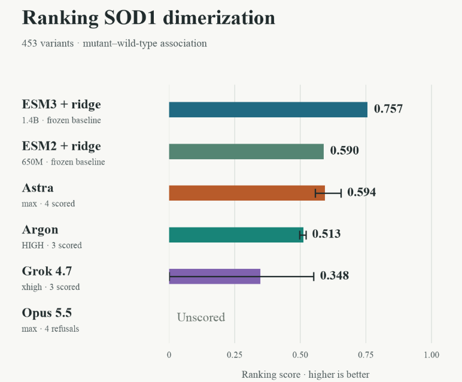

---
tags:
  - source
---

# Claude was Trained on Protein Sequences at Scale

> [Claude was Trained on Protein Sequences at Scale](https://xinmingtu.cn/blog/2026/claude-opus-5-5-protein-sequences/) 原文摘录:
>
> ## Motivation
>
> Frontier LLMs have started to look good at protein tasks. Atharv Jayprakash showed GPT-6 Astra ranking SOD1 variants as well as ESM-2, and PG-LLM found the same across many proteins. Did these models learn from protein sequence databases such as UniProt, or from what is written about proteins?  
> 前沿大语言模型开始在蛋白质相关任务上表现出色. Atharv Jayprakash 发现, GPT-6 Astra 对 SOD1 变体的排序表现与 ESM-2 相当. PG-LLM 在多种蛋白质上也得出了类似结果. 这些模型的能力究竟来自 UniProt 等数据库里的蛋白质序列, 还是来自关于蛋白质的文字资料?  
>
> Famous proteins can’t tell the two apart: GFP is printed in countless papers, and most frontier models recite it. So we tested proteins that almost nobody writes about.  
> 用知名蛋白质很难区分这两种来源. 绿色荧光蛋白 (GFP) 的序列出现在无数篇论文里, 大多数前沿模型都能背出来. 因此, 我们选了几乎没人撰文研究的蛋白质来测试.  
>
> ## Method: next-amino-acid prediction on little-studied proteins
>
> We give a model the start of a protein and ask for the next amino acids. Then we ask again on a shuffled copy of the same protein. Shuffling keeps the letters and destroys their order, so the difference in accuracy measures what the model knows about the sequence itself.  
> 给模型一段蛋白质序列的开头, 让它预测接下来的氨基酸. 然后打乱同一条序列, 再做一次同样的测试. 打乱只改变氨基酸的排列顺序, 保留每种氨基酸的数量. 两种情况下的预测准确率之差, 衡量的是模型对序列本身的了解程度.  
>
> The test set is 668 bacterial and archaeal proteins from 167 Pfam families of unknown function. No family has a solved structure or more than three papers, and no protein has a close relative in UniProt. Each protein is cut at five points. At each cut the model writes the next 10 amino acids, and we score the first. Thinking is at its lowest setting.  
> 测试集包含 668 种细菌和古菌蛋白质, 来自 167 个功能未知的 Pfam 家族. 这些家族都没有已解析的结构, 相关论文也都不超过 3 篇. 测试集中的每种蛋白质在 UniProt 中都没有近缘蛋白. 每条序列选取 5 个截断位置. 在每个位置, 模型预测紧接着的 10 个氨基酸, 评分时只看第 1 个是否正确. 模型的推理强度设为最低档.  
>
> ## Results: only the latest Claude models predict them
>
> Fable 5.2 gets the next amino acid right 54% of the time on real proteins and 9% on shuffled ones. The gap is there in nearly every family, not just a few easy ones. It appears in Opus 4.7, jumps in Opus 5.5, and jumps again in Fable 5.2. GPT, Gemini and the seven open-weight models (DeepSeek V4.1 Flash, Qwen 3.8, Kimi K3.1 Pro, GLM-5.3, MiniMax M3, gpt-oss-120b and Nemotron 3 Ultra) stay near zero, even when they simply continue raw FASTA text, the way they were trained. The latest Claude models also write runs of correct residues that other models rarely manage.  
> 只有最新几代 Claude 模型能有效预测这些序列. Fable 5.2 在真实序列上的下一氨基酸预测准确率为 54%, 在打乱的序列上为 9%. 几乎每个家族都能看到这一差距, 少数容易预测的家族无法解释整体结果. 这一差距从 Opus 4.7 开始出现, 到 Opus 5.5 明显扩大, 到 Fable 5.2 又进一步扩大. GPT、Gemini 和 7 个开放权重模型 (DeepSeek V4.1 Flash、Qwen 3.8、Kimi K3.1 Pro、GLM-5.3、MiniMax M3、gpt-oss-120b 和 Nemotron 3 Ultra) 在真实序列与打乱序列上的准确率差都接近于零. 即便让它们按训练时的方式直接续写原始 FASTA 文本, 结果也是如此. 最新几代 Claude 模型还能连续预测对多个残基, 其他模型很少做到这一点.  

**SOD1 Variants**: 铜锌超氧化物歧化酶, 两个 SOD1 蛋白分子可以结合成一个二聚体. 这里的变体是相对于野生型 SOD1 有氨基酸序列差异的版本.  
**Ranking**: Jayprakash 给 GPT-6 Astra **453 条变体的 amino acid sequence 和实验类型**, 隐去实测读数, 并且禁用工具和联网. GPT-6 Astra 要预测每个变体的二聚化读数. 例如, 如果 A 的实测读数高于 B, 模型也应该把 A 排在 B 前面. 图里的分数衡量预测排序与实测排序的吻合程度, 但原帖和图没有交代具体公式, 因此无法确认用的是 Spearman、Kendall 还是其他指标.  
图上标的是 ESM2 + ridge, 用的是冻结权重的 **ESM-2 650M** ([Evolutionary-scale prediction of atomic-level protein structure with a language model (Zeming Lin et al, 2023)](https://www.science.org/doi/10.1126/science.ade2574)). 按图中标注, ESM-2 负责把序列转换成数值特征, **ridge regression (岭回归) 再用带标签的数据学习如何把这些特征映射到二聚化读数**. 两套方法最终都给出预测读数, 可以按排序表现比较. 原帖和图没有交代 ESM-2 特征如何提取、岭回归用哪些数据拟合, 或训练与测试如何划分. 所以「相当」能确认的是这张图上两套方法的分数接近.  

> UniProt SOD1 条目: <https://www.uniprot.org/uniprotkb/P00441/entry>.  
> Jayprakash 原帖: <https://x.com/atharvjay872/status/2121477118450340342>.  
> Ranking SOD1 Dimerization:   
>
> 简而言之「GPT-6 Astra 直接给每个 SOD1 变体预测一个二聚化读数; ESM-2 先把每条变体序列转成特征, 再由 ridge regression 给出预测读数.」

`So we tested proteins that almost nobody writes about.` 主测试集用了 668 条来自细菌和古菌的蛋白质序列, 分属 167 个功能未知的 Pfam 家族, 每个家族选 4 条, $167 \times 4 = 668$. 在每条序列的 Pfam 结构域内随机选 5 个截断点, 每个点距结构域两端至少 10 个残基, 前面至少有 30 个残基可作为输入. 把截断点之前的序列给模型, 让它续写接下来的 10 个氨基酸, 主指标只看第 1 个是否预测正确. 然后把整条原序列打乱一次, 保留每种氨基酸的数量, 在相同的 5 个位置重复测试, 用打乱后的序列判分. 模型的推理强度设为最低档. 原序列和打乱序列各有 3,340 道题, 最后用原序列的准确率减去打乱序列的准确率, 衡量模型利用氨基酸排列顺序带来的预测优势. Methods · Appendix E.

> 这项实验可复现, 作者公开了测试集、代码和逐题的模型回复 <https://github.com/XinmingTu/LLM-bioseq-probe>.
>
> 对于 result, 不排除 selective reporting (选择性报告) 的可能. 博客报告了几项补充结果, 差距在多数家族里都出现了, 换到较小的家族、换到作者认为晚于训练截止日期公开的序列, 也仍然能看到. 这些结果削弱了「恰好挑中了几个对 Claude 有利的家族」的解释, 但都沿用了同一种序列续写任务. 但依然存在可能, 作者进行了更多内部的实验, 在看到其他实验的结果后才选定这项, Claude 模型表现明显领先的任务作为主实验.
